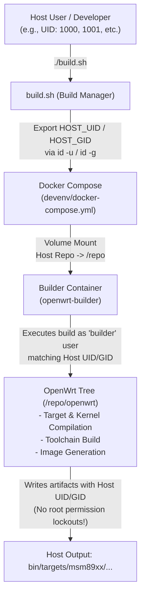
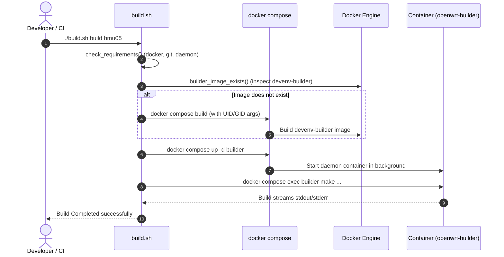

> 📄 本文件是 [README.md](README.md) 的英文原文中文译本，内容以英文版为准。

# Docker 构建环境架构与管理指南

全面讲解 **Qualcomm MSM8916 的 OpenWrt** 中容器化构建系统、动态主机用户
同步（UID/GID）、容器生命周期编排与构建执行的指南。

---

## 1. 概述与架构理念

为 Qualcomm MSM8916（AArch64 / ARMv7 / 32-bit Hyp / Modem 接口）编译
OpenWrt 固件并交叉编译内核组件，需要大量的构建工具链、特定的交叉编译器
（`gcc-aarch64-linux-gnu`、`gcc-arm-none-eabi`）、Python 模块、设备树编译器、
密码学工具以及特定版本的系统库。

为了保证 **100 % 确定性的构建**、防止污染宿主操作系统，并确保在不同的
开发者机器和 GitHub Actions CI runner 上都能无缝运行，所有编译都在容器化
的 Docker 构建环境中进行。



---

## 2. 组件分解

容器环境构建在 [`devenv/`](../../devenv/) 目录之下，并通过根脚本编排：

```
msm8916-openwrt/
├── build.sh                     # Host-side orchestrator and Docker caller
├── devenv/
│   ├── .env                     # Project version configuration (OPENWRT_VERSION)
│   ├── Dockerfile               # Base Ubuntu 22.04 image with builder user
│   ├── dependencies.sh          # Dependency installation script
│   └── docker-compose.yml       # Service definition, mounts, user mapping
├── scripts/
│   ├── openwrt-prepare.sh       # In-container tree prep & feed synchronization
│   └── openwrt-version.sh       # Target version switch helper
└── Docs/
    └── Docker/
        └── README.md            # This documentation
```

### 2.1. `devenv/Dockerfile`
基于 `ubuntu:22.04` 构建镜像（`devenv-builder`）：
1. 执行 `devenv/dependencies.sh` 安装所有必需的工具链和依赖。
2. 接受构建参数 `UID` 和 `GID`。
3. 创建与指定 UID 和 GID 匹配的非 root 用户 `builder`，将其加入 `sudo`
   组并授予免密 sudo 权限。
4. 设置默认 `WORKDIR /repo/openwrt` 和非 root 的 `USER builder`。

### 2.2. `devenv/dependencies.sh`
在一个可缓存层中安装所有主机先决条件：
- **构建基础与核心工具**：`gcc`、`g++`、`make`、`binutils`、`bzip2`、
  `patch`、`gawk`、`flex`、`bison`、`bc`、`time`。
- **交叉编译器**：`gcc-aarch64-linux-gnu`（64 位 kernel/用户态）、
  `gcc-arm-none-eabi`（裸机固件 / lk2nd 和 qhypstub 等二级加载器）。
- **Android / Qualcomm 工具**：`mkbootimg`、`device-tree-compiler` (dtc)、
  `e2fsprogs`、`fdisk`、`util-linux`。
- **库与头文件**：`libelf-dev`、`libfdt-dev`、`libncurses5-dev`、
  `libssl-dev`、`zlib1g-dev`。
- **脚本与解释器**：`python3-dev`、`python3-setuptools`、
  `python3-cryptography`、`perl`、`golang-go`、`swig`。

### 2.3. `devenv/docker-compose.yml`
定义 `builder` 服务配置：
- **镜像**：`devenv-builder`
- **容器名**：`openwrt-builder`
- **构建上下文与参数**：通过 `${HOST_UID:-1000}` 和 `${HOST_GID:-1000}`
  动态传入主机 UID/GID。
- **用户映射**：`user: "${HOST_UID:-1000}:${HOST_GID:-1000}"`，确保操作以
  匹配的主机权限运行。
- **卷挂载**：把根仓库 `..` 映射到容器内的 `/repo`。
- **网络**：`network_mode: host`，为 feed 更新、源码 tarball 下载和代理
  环境提供不受限的访问。
- **交互 TTY**：`stdin_open: true` 和 `tty: true`，用于 `make menuconfig`
  和交互式容器 shell。

### 2.4. `devenv/.env`
保存项目级配置：
```env
OPENWRT_VERSION=v25.12.6
```
*（动态用户 ID 不再存放在这里，以避免在不同开发者系统间造成硬编码的环境
污染）。*

---

## 3. 主机用户同步（UID / GID）

### 3.1. 根本问题：Docker 中的文件权限
当 Docker 把主机目录挂载进容器（`-v $(pwd):/repo`）时，容器内进程创建的
文件继承的是容器用户的数字 UID/GID。

- **如果容器以 `root`（UID 0）运行**：写到主机上的文件（例如
  `openwrt/bin/`、`.config`、构建产物）归 `root` 所有。主机上的开发者
  不借助 `sudo` 无法编辑、git checkout 或 `rm -rf` 这些文件。
- **如果容器硬编码为 `UID=1001` 运行**：在 UID 为 `1000`（Ubuntu 标准
  默认值）的主机上的开发者会发现所有生成的文件归 `1001` 所有，导致
  `Permission denied` 错误。
- **如果容器硬编码为 `UID=1000` 运行**：UID 为 `1001` 的开发者（例如在
  多用户系统或 CI runner 上）会遇到同样的权限冲突。

### 3.2. 为什么 `.env` 中的 `HOST_UID=1001` 是反模式
以前，`devenv/.env` 包含：
```env
HOST_UID=1001
HOST_GID=1001
```
因为 `devenv/.env` 被 git 跟踪：
1. 它硬编码了某一台机器的特定 UID（`1001`）。
2. 任何在标准 `1000:1000` 环境下克隆该仓库的开发者都会被迫使用 UID
   `1001`，破坏其本机的文件所有权。
3. 每个新开发者或新机器都需要手工编辑 `.env`。

### 3.3. 可移植的动态方案
构建系统在运行时动态确定并传播主机用户的 UID/GID：

1. **在 [`build.sh`](../../build.sh) 中**：
   `docker_compose()` 包装器通过 `id -u` 和 `id -g` 自动求值当前用户：
   ```bash
   docker_compose() {
       HOST_UID="${HOST_UID:-$(id -u)}" \
       HOST_GID="${HOST_GID:-$(id -g)}" \
       docker compose \
           -f "$COMPOSE_FILE" \
           "$@"
   }
   ```
2. **在 [`devenv/docker-compose.yml`](../../devenv/docker-compose.yml) 中**：
   若未通过 `build.sh` 调用则默认为 `1000`，通过 `build.sh` 调用时则使用
   导出的 `HOST_UID` 和 `HOST_GID`：
   ```yaml
   args:
     UID: ${HOST_UID:-1000}
     GID: ${HOST_GID:-1000}
   user: "${HOST_UID:-1000}:${HOST_GID:-1000}"
   ```
3. **在 [`devenv/Dockerfile`](../../devenv/Dockerfile) 中**：
   用户创建逻辑安全地处理已存在的组和用户：
   ```dockerfile
   ARG UID=1000
   ARG GID=1000

   RUN if ! getent group ${GID} >/dev/null; then \
           groupadd -g ${GID} builder; \
       fi && \
       if ! getent passwd ${UID} >/dev/null; then \
           useradd -m -u ${UID} -g ${GID} -G sudo builder; \
       fi && \
       echo '%sudo ALL=(ALL) NOPASSWD:ALL' >> /etc/sudoers
   ```

**结果**：
- 对任何用户都开箱即用（`UID 1000`、`UID 1001`、macOS 用户、CI runner）。
- 完全无需手工修改 `.env` 文件。
- 生成的构建输出和 git worktree 始终归调用者所有。

---

## 4. 容器生命周期与调用流程

主机脚本 [`build.sh`](../../build.sh) 透明地管理容器的整个生命周期。



### 4.1. `build.sh` 中的核心编排函数

| 函数 | 用途 | 实现细节 |
| :--- | :--- | :--- |
| `check_requirements()` | 预检 | 校验 `docker` CLI、运行中的守护进程、`git` 以及所需的辅助脚本。 |
| `docker_compose()` | Compose 包装器 | 设置动态 `HOST_UID` / `HOST_GID` 并指向 `devenv/docker-compose.yml`。 |
| `builder_image_exists()` | 镜像校验 | 检查 Docker 守护进程中是否存在 `devenv-builder` 镜像。 |
| `build_image()` | 构建容器 | 运行 `docker compose build` 并使 `.builder-state` 失效。 |
| `ensure_builder()` | 服务保障 | 缺失时构建镜像，通过 `up -d` 启动容器，并检查健康状态。 |
| `docker_exec()` | 容器内命令运行器 | 调用 `docker_compose exec builder "$@"`。 |
| `run_openwrt_make()` | Make 任务运行器 | 在 `/repo/openwrt` 内执行 `make` 目标，失败时输出详细日志。 |

---

## 5. 开发者工作流与命令

所有交互都通过 `./build.sh` 完成。你几乎不需要手动调用 `docker` 或
`docker compose`。

### 5.1. 常用命令

```bash
# 1. Build or update the Docker image
./build.sh image

# 2. Prepare the OpenWrt source tree inside the container
./build.sh prepare

# 3. Compile firmware for a specific board
./build.sh build hmu05

# 4. Compile firmware for all supported boards (hmu05, ufi001b, uz801, uf02, mf800b)
./build.sh build all

# 5. Clean and rebuild
./build.sh rebuild hmu05

# 6. Run interactive menuconfig inside the container
./build.sh menuconfig hmu05

# 7. Save updated kernel/package config back to board diffconfig
./build.sh saveconfig hmu05

# 8. Open an interactive shell inside the running builder container
./build.sh shell

# 9. Clean build directories
./build.sh clean      # make clean
./build.sh dirclean   # make dirclean
./build.sh distclean  # make distclean
```

### 5.2. 直接访问容器 shell
如果你需要在容器内直接调试：
```bash
./build.sh shell
```
容器内：
- 工作目录是 `/repo/openwrt`。
- 你以 `builder` 登录（带免密 `sudo`）。
- 整个项目仓库挂载在 `/repo`。

---

## 6. 持续集成（GitHub Actions）

在 GitHub Actions workflow 中（例如
[`.github/workflows/build-and-release.yml`](../../.github/workflows/build-and-release.yml)），
流水线的执行方式与本地环境完全一致：

1. Runner 用户是 `runner`（`UID 1001`，`GID 127` 或 `1001`）。
2. `./build.sh prepare` 自动从 runner 环境捕获 `HOST_UID=1001` 和
   `HOST_GID=1001`。
3. 构建镜像并启动 `openwrt-builder`。
4. 构建目标直接输出到 `openwrt/bin/targets/msm89xx/msm8916/`。
5. 校验和生成与发布打包会立即读取这些文件，没有权限冲突。

---

## 7. 故障排查与 FAQ

### Q1：在 Docker 中构建后，于主机上编辑文件时出现 Permission denied
**原因**：Docker 容器启动时的 UID 与你的主机用户 ID 不同（例如，如果文件
之前是用硬编码的 UID 1000 构建的，而你是 UID 1001）。  
**解决方法**：
1. 一次性修正现有文件所有权：
   ```bash
   sudo chown -R $(id -u):$(id -g) .
   ```
2. 重新构建镜像以注册你当前的 UID：
   ```bash
   ./build.sh image
   ```

### Q2：容器启动失败，或提示 `service failed to start`
**检查容器状态和日志**：
```bash
docker compose -f devenv/docker-compose.yml logs builder
docker ps -a | grep openwrt-builder
```
**重置并重建容器**：
```bash
docker compose -f devenv/docker-compose.yml down -v
./build.sh prepare
```

### Q3：如何不使用缓存强制重建 Docker 镜像？
```bash
docker compose -f devenv/docker-compose.yml build --no-cache
```

### Q4：容器内 OpenWrt feed 下载失败
因为 `docker-compose.yml` 使用 `network_mode: host`，容器与主机共享完全
相同的网络接口、DNS 和路由表。
- 如果你使用公司代理或 VPN，请在运行 `./build.sh` 之前确保主机上已导出
  `http_proxy` / `https_proxy`。
- 在容器内测试网络：
  ```bash
  ./build.sh shell
  curl -I https://git.openwrt.org
  ```
