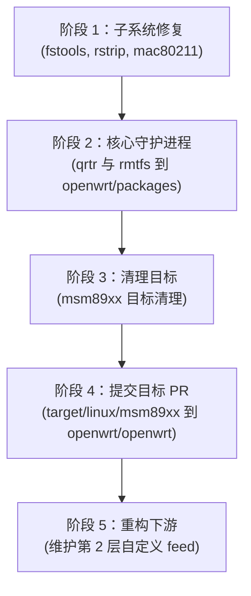

# 上游 OpenWrt 集成策略

*将 Qualcomm Snapdragon 410（MSM8916/MSM89xx）硬件支持合并进官方上游 OpenWrt，同时保留下游社区体验的路线图。*

---

## 1. 执行摘要

此仓库（`msm8916-openwrt`）不是 OpenWrt 的瘦分叉；它是一个**全面、有主见的下游发行版**，专为 4G LTE USB 加密狗和口袋路由器定制。它结合了：

1. **架构与目标代码**：`target/linux/msm89xx`（SoC 启用、Linux 6.12、设备树、镜像配方）。
2. **内核驱动改进**：主线 CPR、BAM-DMUX 稳定性补丁、PM8916 电池电量计、TSENS 延迟。
3. **核心子系统回移与修复**：Qualcomm WCN36xx Wi-Fi（WPA3-SAE、并发 AP+STA）、`fstools`、`rstrip.sh`。
4. **用户空间守护进程与库**：`qrtr`、`rmtfs`、`libqmi` 补丁、BlueZ SPP 工具。
5. **交钥匙产品定制**：Feelgood 主题、自定义 SMS 管理器、电池监视器、APK OTA 签名密钥、failsafe/恢复分区辅助工具，以及 100+ 默认包的有主见选择。

试图将此仓库作为单个单体拉取请求提交到 `openwrt/openwrt.git` 会导致**立即拒绝**。OpenWrt 维护者要求：
* 跨不同上游仓库的严格模块化（`openwrt.git`、`packages.git`、`luci.git`）。
* 最小的 `DEFAULT_PACKAGES`（仅硬件启动和提供网络严格需要的内容）。
* **零不透明二进制 blob** 检入目标源码树。
* 早期 preinit 和 `sysupgrade` 的严格 POSIX `ash` shell 执行（不依赖 `/bin/bash`）。
* 带正确子系统前缀和 `Signed-off-by` 行的原子 git 提交。

要成功合并你的工作，你必须执行基于**两层架构**的**分解与上游化策略**。

---

## 2. 两层架构模型

主要的商业和社区 OpenWrt 下游项目（如 GL.iNet、Teltonika、Turris 和 FriendlyWrt）保持干净的两层分离：

```
┌────────────────────────────────────────────────────────────────────────┐
│                   第 1 层：上游 OpenWrt（官方）                          │
│                                                                        │
│  [openwrt/openwrt.git]         [openwrt/packages.git]                  │
│  ├── target/linux/msm89xx/      ├── utils/qrtr                         │
│  ├── mac80211 wcn36xx 补丁      └── utils/rmtfs                        │
│  └── 核心修复（fstools 等）                                             │
└───────────────────────────────────┬────────────────────────────────────┘
                                    │ 拉入 / 构建于其上
┌───────────────────────────────────▼────────────────────────────────────┐
│            第 2 层：社区定制 / 自定义 feed（下游）                        │
│                                                                        │
│  ├── 包 feed：luci-app-sms-manager、luci-theme-feelgood                 │
│  ├── 硬件刷写器：flash.sh、generate_squashfs_gpt.sh                    │
│  ├── 专有 / 提取辅助工具：msm-firmware-dumper、diag-nv                  │
│  └── 交钥匙配置：Tailscale、Zerotier、BBR 默认、自定义密钥              │
└────────────────────────────────────────────────────────────────────────┘
```

* **第 1 层（上游 OpenWrt）**：纯粹专注于 SoC 启用、设备树、内核稳定性和基础 sysupgrade。一旦合并，OpenWrt buildbots 为 MSM8916 设备生成官方快照和发布镜像。
* **第 2 层（此仓库）**：成为专用的社区层 / 外部包 feed，用户或镜像构建者在官方 OpenWrt 之上覆盖，以获得专门的加密狗体验。

---

## 3. 组件分流矩阵

此仓库中的每个组件映射到一个特定的上游目的地，或必须留在下游：

| 仓库中的路径 | 它是什么 | 上游目的地 | 提交前所需操作 |
| :--- | :--- | :--- | :--- |
| `msm89xx/` | 目标定义、`config-6.12`、子目标 `msm8916` | `openwrt/openwrt.git`（`target/linux/msm89xx`） | 修剪 `DEFAULT_PACKAGES`，移除 `diag_nv.bin`，从 `platform.sh` 移除 bash 依赖。 |
| `msm89xx/patches/` | 内核驱动和 DTS 补丁 | `openwrt/openwrt.git`（`target/linux/msm89xx/patches`） | 清理头部，添加 `Signed-off-by`，用 `make target/linux/refresh` 刷新。 |
| `openwrt-overlay/.../mac80211/` | WCN36xx 驱动补丁（WPA3、并发） | `openwrt/openwrt.git`（`package/kernel/mac80211`） | 作为专用 Wi-Fi PR 提交；理想情况下将驱动修复推送到 `linux-wireless` 邮件列表。 |
| `openwrt-patches/0001-package-pack...` | `include/package-pack.mk` IDIR 修复 | `openwrt/openwrt.git` | 作为小型独立 PR 提交，带清晰的提交理由。 |
| `openwrt-patches/810-rstrip...` | 跳过剥离运营商 MBN 文件 | `openwrt/openwrt.git`（`scripts/rstrip.sh`） | 作为独立构建系统 PR 提交。 |
| `openwrt-patches/811-wifi-sta...` | `netifd` 无线脚本 STA 守卫 | `openwrt/openwrt.git`（`package/network/config/wifi-scripts`） | 提议为干净的 netifd mac80211 脚本增强。 |
| `openwrt-overlay/.../fstools/` | `0001-block-skip-nonexistent-fstab...` | `openwrt/openwrt.git` 或 `openwrt/fstools.git` | 作为干净的 bugfix PR 提交。 |
| `packages/qrtr` | Qualcomm IPC 路由器守护进程与库 | `openwrt/packages.git`（`utils/qrtr`） | 用 OpenWrt 包指南标准化 Makefile。 |
| `packages/rmtfs` | Qualcomm 远程文件系统守护进程 | `openwrt/packages.git`（`utils/rmtfs`） | 添加 init 脚本，验证 BSD-3-Clause 许可，向 `packages.git` 提交 PR。 |
| `packages/luci-app-sms-manager` | SMS Web GUI | `openwrt/luci.git` 或自定义 feed | 若与目标特定路径解耦，可提交到 LuCI feed。 |
| `packages/luci-app-battery` | PM8916 电池 Web GUI | `openwrt/luci.git` 或自定义 feed | 可提交到 LuCI feed。 |
| `packages/luci-theme-feelgood` | 自定义 Feelgood 主题 | **保留下游** | 上游 LuCI 拒绝厂商主题；通过社区 feed 分发。 |
| `msm89xx/base-files/.../diag_nv.bin` | 预编译的 64 位 ELF 工具 | **保留下游** | 永不提交二进制。如需要，提供带 `Makefile` 的开源 C 源码。 |
| `msm89xx/base-files/.../apk/` | 自定义 APK 签名密钥与仓库列表 | **保留下游** | 上游 OpenWrt 使用自己的官方包签名密钥和仓库。 |

---

## 4. 分阶段上游化路线图

按顺序遵循这 4 个阶段。早期阶段建立维护者信任，使最终目标审查顺畅得多。



---

### 阶段 1：核心子系统拉取请求（快速取胜）

针对 `openwrt/openwrt.git` 提交独立的、原子的 PR，用于一般 bugfix：

1. **`fstools` fstab 处理**：
   * 文件：`openwrt-overlay/package/system/fstools/patches/0001-block-skip-nonexistent-fstab-in-config-try-load.patch`
   * 提交主题：`fstools: skip nonexistent fstab in config_try_load`
   * 解释缺少 `/etc/config/fstab` 在 preinit 期间导致不必要失败的边缘情况。

2. **`rstrip.sh` 运营商 MBN 保护**：
   * 文件：`openwrt-patches/810-rstrip-skip-carrier-mcfg.patch`
   * 提交主题：`scripts/rstrip.sh: do not strip Qualcomm carrier configuration MBN files`
   * 解释 ELF 剥离在包安装期间损坏 Qualcomm 运营商 MBN 二进制。

3. **`mac80211` / `wcn36xx` 驱动补丁**：
   * 文件位于：`openwrt-overlay/package/kernel/mac80211/patches/ath/`
   * 具体包括：
     * `450-wcn36xx-only-send-mc-list-when-sta-associated.patch`
     * `451-wcn36xx-mfp-wpa3.patch`
     * `452-wcn36xx-iface-combinations.patch`
     * `458-wcn36xx-bmps-concurrency-guard.patch`
     * `459-wcn36xx-rx-survey-null-band.patch`
   * 注意：维护者会询问这些补丁是否被 Linux 内核上游（`linux-wireless`）接受。如果它们来自 mainline 或 `wireless-next` 的回移，提及上游提交哈希。如果它们是自定义 bugfix，用完整解释干净地格式化。

---

### 阶段 2：将上游 Qualcomm 守护进程提交到 `openwrt/packages.git`

`msm89xx` 目标需要 `qrtr` 和 `rmtfs` 来访问基带固件和调制解调器分区。上游 OpenWrt 不把这些放在核心仓库中；它们属于 `packages` feed。

1. Fork `https://github.com/openwrt/packages`。
2. 添加包目录：
   * `utils/qrtr`：[`packages/qrtr`](file:///home/shaanair/Projects/msm8916-openwrt-clean/packages/qrtr) 的清理版本。
   * `utils/rmtfs`：[`packages/rmtfs`](file:///home/shaanair/Projects/msm8916-openwrt-clean/packages/rmtfs) 的清理版本。
3. 验证：
   * 包必须使用标准 `rules.mk` 和 `package.mk` 构建。
   * 检查许可（`BSD-3-Clause`）、维护者字段和 init 脚本。
4. 在 `openwrt/packages` 上打开针对 `master` 的 PR。

---

### 阶段 3：清理 `target/linux/msm89xx`

在打开目标拉取请求前，目标目录必须清除所有下游产品定制。

#### 1. 修剪 `msm89xx/Makefile` `DEFAULT_PACKAGES`
上游目标只能选择启动和连接所需的包。
* **移除**：
  `avahi-dbus-daemon`、`bluez-*`、`bt-*`、`cups`、`luci*`、`nano`、`strace`、`tailscale`、`zerotier`、`zram-swap`、`kmod-sched-bbr` 等。
* **严格保持最小**：
  ```makefile
  DEFAULT_PACKAGES += \
      kmod-usb-chipidea kmod-usb-gadget-eth \
      kmod-wcn36xx kmod-qcom-rproc-wcnss kmod-qcom-rproc \
      kmod-rpmsg-wwan-ctrl kmod-bam-dmux kmod-qcom-rproc-modem \
      kmod-gpio-button-hotplug \
      rmtfs qrtr-utils partx-utils e2fsprogs f2fs-tools
  ```

#### 2. 清理 `msm89xx/base-files/`
* **删除二进制 blob**：
  ```bash
  rm -f msm89xx/base-files/usr/libexec/diag_nv.bin
  ```
  *（如果 diag NV 访问必需，通过包 Makefile 从源码构建开源工具）。*
* **删除下游密钥与 feeds**：
  ```bash
  rm -rf msm89xx/base-files/etc/apk/
  ```
* **从目标 base-files 移除 LuCI 控制器钩子**：
  移除 `usr/lib/lua/luci/controller/reboot-modes.lua` 和相关 `.htm` 模板。目标 base-files 绝不能假设已安装 LuCI。
* **清除 `lib/upgrade/platform.sh` 中的 Bash 依赖**：
  OpenWrt preinit 和 sysupgrade 在 BusyBox `ash` 下运行。移除 `/bin/bash` 调用和 `platform.bash`。升级脚本必须 100% POSIX `/bin/sh` 兼容。

#### 3. 规范化设备定义（`image/msm8916.mk`）
* 确保设备定义严格使用 OpenWrt 的设备宏：
  ```makefile
  define Device/generic-ufi001b
    $(Device/msm8916)
    DEVICE_VENDOR := Generic
    DEVICE_MODEL := UFI001B
    DEVICE_DTS := msm8916-generic-ufi001b
    SUPPORTED_DEVICES := ufi001b,250605v0s
    DEVICE_PACKAGES := wpad-basic-wolfssl uci-usb-gadget
  endef
  TARGET_DEVICES += generic-ufi001b
  ```
* 除非通过标准 OpenWrt `IMAGE/...` 规则实现，否则从标准构建流程中移除专有恢复生成脚本。

#### 4. 刷新内核配置与补丁
以 OpenWrt `main` 为目标（它使用 Linux 6.12 或当前开发内核）。
```bash
# 在你的 OpenWrt 检出中
make target/linux/msm89xx/refresh V=s
```
验证 `msm89xx/patches/` 中每个补丁都有：
1. 标准头部（`From ...`、`Subject: [PATCH] ...`）
2. 问题与解决方案的说明
3. `Signed-off-by: Real Name <email>`

---

### 阶段 4：git 提交流程

1. **Fork 并检出 `main`**：
   ```bash
   git clone https://github.com/openwrt/openwrt.git upstream-openwrt
   cd upstream-openwrt
   git checkout -b target-msm89xx origin/main
   ```
   *（始终以 `main` 为目标。OpenWrt 从不直接接受新目标到稳定发布分支如 24.10 或 25.12）。*

2. **复制清理后的目标目录**：
   ```bash
   cp -a /path/to/msm8916-openwrt-clean/msm89xx target/linux/msm89xx
   ```

3. **检查提交规则**：
   提交主题：
   `target/linux/msm89xx: add Qualcomm Snapdragon 410 (MSM8916) support`

   提交正文：
   * 硬件描述（Snapdragon 410 / MSM8916 四核 Cortex-A53）。
   * 支持的板卡列表（UZ801、UFI001B、UFI003、HMUF02、MF800B、MIFIB-V12）。
   * 测试功能的确认（启动、eMMC rootfs、USB gadget 网络、Wi-Fi AP/STA、LTE 调制解调器数据呼叫、Sysupgrade）。
   * 必需行：`Signed-off-by: Your Name <your.email@example.com>`。

4. **从零验证构建**：
   ```bash
   make defconfig
   make target/linux/msm89xx/compile -j$(nproc) V=s
   ```

5. **提交拉取请求**：
   * 在 GitHub 上针对 `openwrt/openwrt:main` 打开 PR。
   * 积极参与维护者审查评论。

---

### 阶段 5：将下游重构为覆盖层 feed

一旦上游 PR 被接受，将此仓库（`msm8916-openwrt`）转变为**社区定制**：

1. **目标跟踪**：
   不携带树外的 `msm89xx/`，你的仓库以 OpenWrt 上游为基础。
2. **专用包 feed（`msm8916-feed`）**：
   保留包如：
   * `luci-theme-feelgood`
   * `luci-app-sms-manager`
   * `luci-app-battery`
   * `luci-app-wifi-sta`
   * `diag-efs`、`diag-logtool`、`msm-firmware-dumper`
   * `qcom-carrier-autocfg`
3. **下游配置 / Diffconfig**：
   使用 `diffconfig` 为想要“交钥匙”调制解调器棒体验的用户预选 BBR、Tailscale、BlueZ 和 Feelgood 主题。

---

## 5. 上游就绪清单

在发布你的目标拉取请求前，对照此清单审计：

- [ ] **无二进制文件**：`git log --stat` 不含 `.bin`、`.elf`、`.tar` 或专有归档。
- [ ] **无专有密钥**：Base-files 不含自定义 APK/OPKG 签名密钥。
- [ ] **Base-files 中无 Bash**：`platform.sh` 和 preinit 脚本在 `ash` 下干净执行。
- [ ] **最小默认包**：`msm89xx/Makefile` 不捆绑自定义主题、CLI 编辑器或非必要网络服务。
- [ ] **内核配置已刷新**：`config-6.12` 不含无效/未解析符号。
- [ ] **所有补丁已记录**：`patches/` 中每个文件都有提交头部和 `Signed-off-by`。
- [ ] **Sysupgrade 已验证**：从镜像到镜像升级保留 `/etc/config` 并通过 CLI 干净完成。
- [ ] **干净的 git 历史**：提交是原子的，并相对 `origin/main` 干净变基。

---

## 6. 参考资料与相关文档

* [架构概述](file:///home/shaanair/Projects/msm8916-openwrt-clean/Docs/ARCHITECTURE.md)
* [补丁与打包映射](file:///home/shaanair/Projects/msm8916-openwrt-clean/Docs/PATCHES_AND_PACKAGING.md)
* [添加设备板卡](file:///home/shaanair/Projects/msm8916-openwrt-clean/Docs/ADDING_A_DEVICE_BOARD.md)
* [Sysupgrade 内部机制](file:///home/shaanair/Projects/msm8916-openwrt-clean/Docs/Sysupgrade/)
* [OpenWrt 提交补丁指南](https://openwrt.org/submitting-patches)
