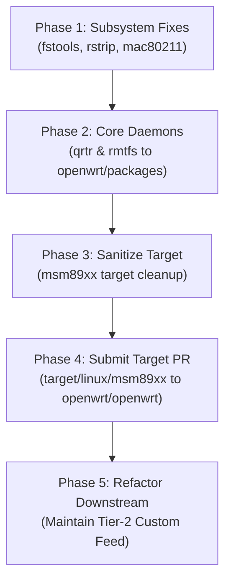

> 📄 本文件是 [OPENWRT_UPSTREAMING_STRATEGY.md](OPENWRT_UPSTREAMING_STRATEGY.md) 的英文原文中文译本，内容以英文版为准。

# 上游 OpenWrt 集成策略

*一份把 Qualcomm Snapdragon 410（MSM8916/MSM89xx）硬件支持合并进官方上游
OpenWrt、同时保留下游社区体验的路线图。*

---

## 1. 执行摘要

本仓库（`msm8916-openwrt`）不是 OpenWrt 的薄 fork；它是一个
**全面的、有主见的下游发行版**，专为 4G LTE USB dongle 和口袋路由器
定制。它结合了：

1. **架构与 Target 代码**：`target/linux/msm89xx`（SoC 启用、
   Linux 6.12、device tree、镜像配方）。
2. **Kernel 驱动改进**：主线 CPR、BAM-DMUX 稳定性 patch、PM8916 电池
   电量计、TSENS 延迟处理。
3. **核心子系统 backport 与修复**：Qualcomm WCN36xx Wi-Fi
   （WPA3-SAE、并发 AP+STA）、`fstools`、`rstrip.sh`。
4. **Userspace 守护进程与库**：`qrtr`、`rmtfs`、`libqmi` patch、
   BlueZ SPP 工具。
5. **交钥匙产品定制**：Feelgood 主题、自定义短信管理器、电池监视器、
   APK OTA 签名密钥、failsafe/recovery 分区辅助工具，以及一套有主见的
   100+ 默认 package 选择。

试图把本仓库作为一个单一的巨型 pull request 提交给
`openwrt/openwrt.git` 会招致**立即拒绝**。OpenWrt 维护者要求：
* 在不同的上游仓库（`openwrt.git`、`packages.git`、`luci.git`）之间
  严格模块化。
* 极简的 `DEFAULT_PACKAGES`（只有硬件启动和提供网络所严格需要的）。
* **零不透明二进制 blob** 被检入 target 源码树。
* 早期 preinit 和 `sysupgrade` 严格使用 POSIX `ash` shell 执行
  （不依赖 `/bin/bash`）。
* 具有正确子系统前缀和 `Signed-off-by` 行的原子 git commit。

要成功合并你的工作，你必须基于**双层架构**执行一套**分解与上游化策略**。

---

## 2. 双层架构模型

主要的商业和社区 OpenWrt 下游项目（如 GL.iNet、Teltonika、Turris 和
FriendlyWrt）都保持着干净的双层分离：

```
┌────────────────────────────────────────────────────────────────────────┐
│                   Tier 1: Upstream OpenWrt (Official)                   │
│                                                                        │
│  [openwrt/openwrt.git]         [openwrt/packages.git]                  │
│  ├── target/linux/msm89xx/      ├── utils/qrtr                         │
│  ├── mac80211 wcn36xx patches   └── utils/rmtfs                        │
│  └── core fixes (fstools, etc.)                                        │
└───────────────────────────────────┬────────────────────────────────────┘
                                    │ pulls in / builds on top
┌───────────────────────────────────▼────────────────────────────────────┐
│              Tier 2: Community Flavor / Custom Feed (Downstream)        │
│                                                                        │
│  ├── Package Feed: luci-app-sms-manager, luci-theme-feelgood           │
│  ├── Hardware Flasher: flash.sh, generate_squashfs_gpt.sh              │
│  ├── Proprietary / Extraction helpers: msm-firmware-dumper, diag-nv    │
│  └── Turnkey Profiles: Tailscale, Zerotier, BBR defaults, custom keys  │
└────────────────────────────────────────────────────────────────────────┘
```

* **Tier 1（上游 OpenWrt）**：纯粹聚焦于 SoC 启用、device tree、
  kernel 稳定性和基础 sysupgrade。一旦合并，OpenWrt buildbot 就会为
  MSM8916 设备生产官方的 snapshot 和 release 镜像。
* **Tier 2（本仓库）**：变成一个专门的社区层 / 外部 package feed，
  用户或镜像构建者将其叠加在官方 OpenWrt 之上，以获得专门的 dongle
  体验。

---

## 3. 组件分诊矩阵

本仓库中的每个组件都对应一个特定的上游归宿，或者必须留在下游：

| 仓库中的路径 | 它是什么 | 上游归宿 | 提交前所需操作 |
| :--- | :--- | :--- | :--- |
| `msm89xx/` | Target 定义、`config-6.12`、subtarget `msm8916` | `openwrt/openwrt.git`（`target/linux/msm89xx`） | 裁剪 `DEFAULT_PACKAGES`，移除 `diag_nv.bin`，从 `platform.sh` 移除 bash 依赖。 |
| `msm89xx/patches/` | Kernel 驱动与 DTS patch | `openwrt/openwrt.git`（`target/linux/msm89xx/patches`） | 清理头部，加上 `Signed-off-by`，用 `make target/linux/refresh` 刷新。 |
| `openwrt-overlay/.../mac80211/` | WCN36xx 驱动 patch（WPA3、并发） | `openwrt/openwrt.git`（`package/kernel/mac80211`） | 作为专门的 Wi-Fi PR 提交；理想情况下把驱动修复推给 `linux-wireless` 邮件列表。 |
| `openwrt-patches/0001-package-pack...` | `include/package-pack.mk` 的 IDIR 修复 | `openwrt/openwrt.git` | 作为小的独立 PR 提交，附上清晰的 commit 理由。 |
| `openwrt-patches/810-rstrip...` | 跳过对运营商 MBN 文件的 strip | `openwrt/openwrt.git`（`scripts/rstrip.sh`） | 作为独立的构建系统 PR 提交。 |
| `openwrt-patches/811-wifi-sta...` | `netifd` 无线脚本的 STA 守卫 | `openwrt/openwrt.git`（`package/network/config/wifi-scripts`） | 作为干净的 netifd mac80211 脚本增强提出。 |
| `openwrt-overlay/.../fstools/` | `0001-block-skip-nonexistent-fstab...` | `openwrt/openwrt.git` 或 `openwrt/fstools.git` | 作为干净的 bugfix PR 提交。 |
| `packages/qrtr` | Qualcomm IPC Router 守护进程与库 | `openwrt/packages.git`（`utils/qrtr`） | 按 OpenWrt package 准则规范 Makefile。 |
| `packages/rmtfs` | Qualcomm Remote Filesystem 守护进程 | `openwrt/packages.git`（`utils/rmtfs`） | 添加 init 脚本，验证 BSD-3-Clause 许可，向 `packages.git` 提 PR。 |
| `packages/luci-app-sms-manager` | 短信 Web GUI | `openwrt/luci.git` 或 Custom Feed | 如果与 target 专属路径解耦，可以提交到 LuCI feed。 |
| `packages/luci-app-battery` | PM8916 电池 Web GUI | `openwrt/luci.git` 或 Custom Feed | 可以提交到 LuCI feed。 |
| `packages/luci-theme-feelgood` | 自定义 Feelgood 主题 | **保留在下游** | 上游 LuCI 拒绝厂商主题；通过社区 feed 分发。 |
| `msm89xx/base-files/.../diag_nv.bin` | 预编译的 64 位 ELF 工具 | **保留在下游** | 绝不提交二进制文件。如果需要，提供开源的 C 源码并配 `Makefile`。 |
| `msm89xx/base-files/.../apk/` | 自定义 APK 签名密钥与 repo 列表 | **保留在下游** | 上游 OpenWrt 使用自己的官方 package 签名密钥和仓库。 |

---

## 4. 分阶段上游化路线图

按顺序遵循这 4 个阶段。早期阶段建立维护者信任，使最终的 target 审查
顺利得多。



---

### 阶段 1：核心子系统 PR（速赢）

针对 `openwrt/openwrt.git` 提交独立、原子的通用 bugfix PR：

1. **`fstools` 的 fstab 处理**：
   * 文件：`openwrt-overlay/package/system/fstools/patches/0001-block-skip-nonexistent-fstab-in-config-try-load.patch`
   * Commit Subject：`fstools: skip nonexistent fstab in config_try_load`
   * 解释缺失 `/etc/config/fstab` 导致 preinit 期间不必要失败的边界情况。

2. **`rstrip.sh` 的运营商 MBN 保护**：
   * 文件：`openwrt-patches/810-rstrip-skip-carrier-mcfg.patch`
   * Commit Subject：`scripts/rstrip.sh: do not strip Qualcomm carrier configuration MBN files`
   * 解释 ELF strip 会在 package 安装期间损坏 Qualcomm 运营商 MBN
     二进制文件。

3. **`mac80211` / `wcn36xx` 驱动 patch**：
   * 所在目录：`openwrt-overlay/package/kernel/mac80211/patches/ath/`
   * 具体为：
     * `450-wcn36xx-only-send-mc-list-when-sta-associated.patch`
     * `451-wcn36xx-mfp-wpa3.patch`
     * `452-wcn36xx-iface-combinations.patch`
     * `458-wcn36xx-bmps-concurrency-guard.patch`
     * `459-wcn36xx-rx-survey-null-band.patch`
   * 注意：维护者会询问这些 patch 是否已在 Linux kernel（`linux-wireless`）
     上游被接受。如果它们是从主线或 `wireless-next` backport 而来，请
     提及上游 commit 哈希。如果是自定义 bugfix，请格式整洁并附上完整
     解释。

---

### 阶段 2：把 Qualcomm 守护进程上游化到 `openwrt/packages.git`

`msm89xx` target 需要 `qrtr` 和 `rmtfs` 来访问基带固件和 modem 分区。
上游 OpenWrt 不在核心仓库中保留它们；它们属于 `packages` feed。

1. Fork `https://github.com/openwrt/packages`。
2. 添加 package 目录：
   * `utils/qrtr`：[`packages/qrtr`](file:///home/shaanair/Projects/msm8916-openwrt-clean/packages/qrtr) 的清理版本。
   * `utils/rmtfs`：[`packages/rmtfs`](file:///home/shaanair/Projects/msm8916-openwrt-clean/packages/rmtfs) 的清理版本。
3. 验证：
   * package 必须能用标准的 `rules.mk` 和 `package.mk` 构建。
   * 检查许可（`BSD-3-Clause`）、maintainer 字段和 init 脚本。
4. 在 `openwrt/packages` 上针对 `master` 开 PR。

---

### 阶段 3：净化 `target/linux/msm89xx`

在开 target pull request 之前，target 目录必须清除所有下游产品定制。

#### 1. 裁剪 `msm89xx/Makefile` 的 `DEFAULT_PACKAGES`
上游 target 只能选择启动和联网所需的 package。
* **移除**：
  `avahi-dbus-daemon`、`bluez-*`、`bt-*`、`cups`、`luci*`、`nano`、
  `strace`、`tailscale`、`zerotier`、`zram-swap`、`kmod-sched-bbr` 等。
* **严格保持极简**：
  ```makefile
  DEFAULT_PACKAGES += \
      kmod-usb-chipidea kmod-usb-gadget-eth \
      kmod-wcn36xx kmod-qcom-rproc-wcnss kmod-qcom-rproc \
      kmod-rpmsg-wwan-ctrl kmod-bam-dmux kmod-qcom-rproc-modem \
      kmod-gpio-button-hotplug \
      rmtfs qrtr-utils partx-utils e2fsprogs f2fs-tools
  ```

#### 2. 清理 `msm89xx/base-files/`
* **删除二进制 blob**：
  ```bash
  rm -f msm89xx/base-files/usr/libexec/diag_nv.bin
  ```
  *（如果需要 diag NV 访问，请写一个通过 package Makefile 从源码构建的
  开源工具。）*
* **删除下游密钥与 feed**：
  ```bash
  rm -rf msm89xx/base-files/etc/apk/
  ```
* **从 target base-files 移除 LuCI 控制器钩子**：
  移除 `usr/lib/lua/luci/controller/reboot-modes.lua` 及相关 `.htm`
  模板。target base-files 绝不能假定 LuCI 已安装。
* **从 `lib/upgrade/platform.sh` 清除 Bash 依赖**：
  OpenWrt 的 preinit 和 sysupgrade 运行在 BusyBox `ash` 下。移除
  `/bin/bash` 调用和 `platform.bash`。升级脚本必须 100% 符合 POSIX
  `/bin/sh`。

#### 3. 规范化设备定义（`image/msm8916.mk`）
* 确保设备定义严格使用 OpenWrt 的设备宏：
  ```makefile
  define Device/generic-ufi001b
    $(Device/msm8916)
    DEVICE_VENDOR := Generic
    DEVICE_MODEL := UFI001B
    DEVICE_DTS := msm8916-generic-ufi001b
    SUPPORTED_DEVICES := ufi001b,250605v0s
    DEVICE_PACKAGES := wpad-basic-wolfssl uci-usb-gadget
  endef
  TARGET_DEVICES += generic-ufi001b
  ```
* 除非通过标准 OpenWrt 的 `IMAGE/...` 规则实现，否则从标准构建流水线
  移除专有的 recovery 生成脚本。

#### 4. 刷新 Kernel 配置与 Patch
对准 OpenWrt `main`（使用 Linux 6.12 或当前开发版 kernel）。
```bash
# In your OpenWrt checkout
make target/linux/msm89xx/refresh V=s
```
验证 `msm89xx/patches/` 中的每个 patch 都具备：
1. 标准头部（`From ...`、`Subject: [PATCH] ...`）
2. 对问题与解决方案的解释
3. `Signed-off-by: Real Name <email>`

---

### 阶段 4：Git 提交工作流

1. **Fork 并检出 `main`**：
   ```bash
   git clone https://github.com/openwrt/openwrt.git upstream-openwrt
   cd upstream-openwrt
   git checkout -b target-msm89xx origin/main
   ```
   *（始终以 `main` 为目标。OpenWrt 从不直接向 24.10 或 25.12 等稳定
   发布分支接收新 target。）*

2. **复制清理后的 target 目录**：
   ```bash
   cp -a /path/to/msm8916-openwrt-clean/msm89xx target/linux/msm89xx
   ```

3. **检查 commit 规则**：
   Commit subject：
   `target/linux/msm89xx: add Qualcomm Snapdragon 410 (MSM8916) support`

   Commit body：
   * 硬件描述（Snapdragon 410 / MSM8916 四核 Cortex-A53）。
   * 受支持板卡列表（UZ801、UFI001B、UFI003、HMUF02、MF800B、
     MIFIB-V12）。
   * 已测试功能的确认（启动、eMMC rootfs、USB gadget 网络、Wi-Fi
     AP/STA、LTE modem 数据呼叫、Sysupgrade）。
   * 强制行：`Signed-off-by: Your Name <your.email@example.com>`。

4. **从零验证构建**：
   ```bash
   make defconfig
   make target/linux/msm89xx/compile -j$(nproc) V=s
   ```

5. **提交 Pull Request**：
   * 在 GitHub 上针对 `openwrt/openwrt:main` 开 PR。
   * 积极回应维护者的审查意见。

---

### 阶段 5：把下游重构为 Overlay Feed

一旦上游 PR 被接受，把本仓库（`msm8916-openwrt`）转型为一个
**社区风味版（community flavor）**：

1. **Target 跟踪**：
   不再携带 out-of-tree 的 `msm89xx/`，你的仓库以上游 OpenWrt 为基础。
2. **专门的 package feed（`msm8916-feed`）**：
   保留诸如以下的 package：
   * `luci-theme-feelgood`
   * `luci-app-sms-manager`
   * `luci-app-battery`
   * `luci-app-wifi-sta`
   * `diag-efs`、`diag-logtool`、`msm-firmware-dumper`
   * `qcom-carrier-autocfg`
3. **下游 Profile / Diffconfig**：
   用 `diffconfig` 为想要"交钥匙"modem stick 体验的用户预选 BBR、
   Tailscale、BlueZ 和 Feelgood 主题。

---

## 5. 上游就绪检查清单

在发布你的 target Pull Request 之前，按此清单审计：

- [ ] **没有二进制文件**：`git log --stat` 不含 `.bin`、`.elf`、
  `.tar` 或专有归档。
- [ ] **没有专有密钥**：base-files 不含自定义 APK/OPKG 签名密钥。
- [ ] **base-files 中没有 Bash**：`platform.sh` 和 preinit 脚本能干净地
  在 `ash` 下执行。
- [ ] **极简默认 package**：`msm89xx/Makefile` 不捆绑自定义主题、CLI
  编辑器或非必要的网络服务。
- [ ] **Kernel 配置已刷新**：`config-6.12` 不含无效/未解析的符号。
- [ ] **所有 patch 有文档**：`patches/` 中每个文件都有 commit 头部和
  `Signed-off-by`。
- [ ] **Sysupgrade 已验证**：从镜像到镜像的升级保留 `/etc/config` 并
  能通过 CLI 干净完成。
- [ ] **干净的 git 历史**：commit 是原子的，并已对 `origin/main`
  干净地 rebase。

---

## 6. 参考与相关文档

* [Architecture Overview](file:///home/shaanair/Projects/msm8916-openwrt-clean/Docs/ARCHITECTURE.md)
* [Patches and Packaging Map](file:///home/shaanair/Projects/msm8916-openwrt-clean/Docs/PATCHES_AND_PACKAGING.md)
* [Adding a Device Board](file:///home/shaanair/Projects/msm8916-openwrt-clean/Docs/ADDING_A_DEVICE_BOARD.md)
* [Sysupgrade Internals](file:///home/shaanair/Projects/msm8916-openwrt-clean/Docs/Sysupgrade/)
* [OpenWrt Submitting Patches Guide](https://openwrt.org/submitting-patches)
