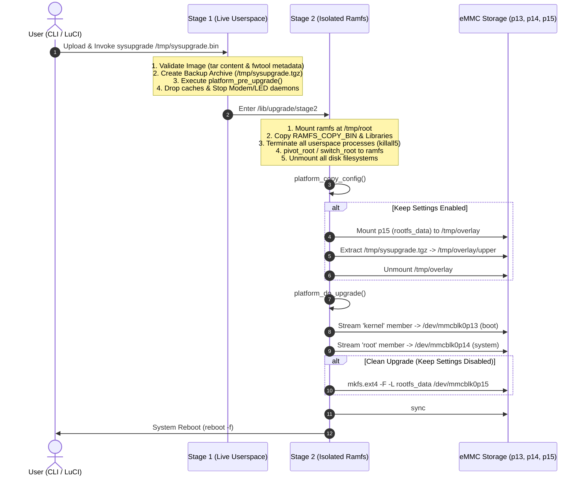

> 📄 本文件是 [MSM8916_Sysupgrade_and_LuCI_Architecture_Guide.md](MSM8916_Sysupgrade_and_LuCI_Architecture_Guide.md) 的英文原文中文译本，内容以英文版为准。

# MSM8916 OpenWrt Sysupgrade 与 LuCI 架构指南

## 1. 执行摘要

本文档针对高通 Snapdragon 410（MSM8916）4G USB 加密狗（HMU05、UFI001B、UZ801v3、UF02），对 OpenWrt 的固件升级机制（`sysupgrade`）和网页界面（`luci-app-sysupgrade` / LuCI Flash Operations）提供完整的技术分析。

它详细说明：
1. **根本原因分析**：为什么 `luci-sysupgrade` 间歇性失败，而命令行 `sysupgrade` 却能工作。
2. **平台修复**：对 `/msm89xx/base-files/lib/upgrade/platform.sh` 应用的架构性修正。
3. **升级生命周期**：对阶段 1（活动用户态）和阶段 2（隔离的 RAM 文件系统）的分步剖析。
4. **命令与参数参考**：`sysupgrade` CLI 和 LuCI GUI 中所有选项的全面对比。
5. **分区架构与存储完整性**：Android `boot.img`（kernel）以及 OpenWrt SquashFS/EXT4 rootfs/overlay 是如何被刷写和保留的。

---

## 2. 根本原因分析：为什么 LuCI Sysupgrade 间歇性失败

在 MSM8916 设备上的实际测试中，用户观察到从 LuCI 发起的 sysupgrade 有时成功、有时失败或卡死，而命令行升级则成功得更频繁。全面的调试确定了以下相互关联的根本原因：

### 根本原因 1：浏览器上传期间的内存压力与 Tmpfs OOM
- **硬件限制**：MSM8916 加密狗拥有 512 MB 总物理 LPDDR3 内存。Linux 内核和高通专有 modem/无线保留内存区域（`mba`、`modem`、`wcnss`、`tz`、`smem`、`venus`）永久占用约 150 MB 到 180 MB，为 Linux 用户态留下约 330 MB 到 360 MB。
- **Tmpfs 重复占用**：OpenWrt 将 `/tmp` 作为 `tmpfs` 挂载在 RAM 中（默认限制：可用 RAM 的 50%，约 160 MB）。
- **LuCI 上传流程**：
  1. LuCI 的 HTTP 服务器（`uhttpd`）将上传的 35 MB `sysupgrade.bin` 流式写入 `/tmp/upload.xxxx`。
  2. LuCI 执行 `sysupgrade --test` 或 `fwtool` 以检查元数据。
  3. 当刷写开始时，`sysupgrade` 创建配置备份归档 `/tmp/sysupgrade.tgz`（1–5 MB）。
  4. 当过渡到阶段 2 时，OpenWrt 创建 ramfs 环境 `/tmp/root` 并复制固件镜像和所需的二进制文件。
- **失败触发条件**：如果内存缓存已饱和且活动守护进程（`ModemManager`、`rmtfs`、`wpad`、`dnsmasq`、`wifi-led-monitor`）正在运行，Linux 的 Out-Of-Memory（OOM）killer 会在过程中途终止 `uhttpd` 或 `sysupgrade`，导致网页 UI 显示 `Connection Lost` 并中止升级。

### 根本原因 2：附加元数据下 `tar` 管道在 `pipefail` 时失败
- OpenWrt 通过将标准 tarball（`sysupgrade-tar`）与末尾附加的 JSON 兼容性元数据（通过 `fwtool` 的 `append-metadata`）拼接来创建 `sysupgrade.bin`。
- 在 `platform.sh` 中，刷写提取管道以前运行：
  ```sh
  set -o pipefail
  tar -O -xf "$tar_file" "$kernel_member" 2>/dev/null | dd of="$boot_part" bs=4096 conv=fsync 2>/dev/null
  ```
- **问题所在**：当 `tar` 从 tar 归档中提取某个成员时，它会扫描过该成员一直到文件末尾。当到达附加在 EOF 处的非 tar JSON 尾部时，标准 GNU `tar` 或 BusyBox `tar` 会以退出码 `1` 或 `2` 退出（`tar: invalid tar magic` / `short read`）。
- 启用 `set -o pipefail` 后，即使 `dd` 已成功将 100% 的 kernel 或 rootfs 写入 eMMC 分区，管道仍返回退出码 `1`，导致 `platform_do_upgrade` 记录 `ERROR: Failed to write kernel to ...` 并中止升级！

### 根本原因 3：阶段 2 RAMFS 二进制文件与动态库不完整
- 在阶段 2（`/lib/upgrade/stage2`）中，OpenWrt 终止所有运行中的进程、卸载 rootfs，并切换到一个小型的 RAM 支撑环境。
- 只有在 `RAMFS_COPY_BIN` 中明确列出的二进制文件和标准 Busybox 内置程序才会被复制到 ramfs 根中。
- 以前，`RAMFS_COPY_BIN` 只包含 `"mkfs.ext4"`。如果从 `/usr/bin` 或 `/usr/sbin` 中安装的 GNU 软件包调用了 GNU `tar`、`fsck.ext4`、`e2fsck`、`sync` 或 `readlink`，它们会因缺少或共享库（`libext2fs`、`libblkid`、`libuuid`）无法解析而失败。
- 如果在干净升级（`sysupgrade -n`）期间阶段 2 中的 `mkfs.ext4` 失败，脚本会以错误退出。

### 根本原因 4：EXT4 Overlay 分区锁定与脏日志
- 当以"保留设置"方式升级时，`platform_copy_config` 会将 `rootfs_data` 分区（`/dev/mmcblk0p15`）挂载到 `/tmp/overlay`。
- 如果 overlay 在阶段 1 的进程拆解期间被非正常卸载，在阶段 2 中挂载它会因日志重放错误而失败，从而阻止配置恢复。

### 根本原因 5：Modem / RMTFS 硬件锁死
- 在高通 MSM8916 上，`rmtfs` 为 Modem DSP（Q6 / MSS）提供共享内存块访问。
- 在 modem DMA 传输活跃时突然终止 `rmtfs`，可能导致 modem 处理器触发高通子系统重启（SSR）或总线锁死，使 SoC 在刷写完成之前挂起。

### 根本原因 6：BusyBox `ash` Shell 特性与 `pipefail` 下的管道失败
- OpenWrt 默认的 `/bin/sh` 是 BusyBox `ash`。当在 `ash` 中执行 shell 管道时：
  - `ash` 不支持 bash 数组语法（例如 `arr=("a" "b")` 会触发致命的解析时错误 `ash: syntax error: unexpected "(" (expecting "}")`）。
  - `ash` 缺少 `${PIPESTATUS[@]}`，无法在管道中单独检查各命令的退出码。
  - 当在 `ash` 中使用 `set -o pipefail` 时，tar 归档尾部填充或附加的 `fwtool` 元数据会导致 `tar` 以非零退出，即使 `dd` 已写入 100% 的分区块，也会触发升级中止的误报。
  - 在 `ash` 中 source 包含任何 bash 特有语法的脚本，会导致 stage2 期间 `include /lib/upgrade` 完全中止。

---

## 3. 平台架构与 Bash 执行引擎

为了在保持与 OpenWrt 标准初始化框架 100% 兼容的同时实现确定性的可靠性，升级系统被拆分为**两级架构**：

```
+-------------------------------------------------------------------------------+
|                    Two-Tier Sysupgrade Architecture                           |
+-------------------------------------------------------------------------------+
|                                                                               |
|  OpenWrt Init / Stage 2 (BusyBox ash)                                         |
|      |                                                                        |
|      v                                                                        |
|  /lib/upgrade/platform.sh (POSIX ash interface)                              |
|      - Sourced by OpenWrt's 'include /lib/upgrade' (only scans *.sh)          |
|      - Defines RAMFS_COPY_BIN (includes /bin/bash and all essential tools)    |
|      - Defines RAMFS_COPY_DATA (includes /lib/upgrade/platform.bash)         |
|      - Thin dispatchers: check if /bin/bash exists, then delegate execution   |
|      |                                                                        |
|      v                                                                        |
|  /lib/upgrade/platform.bash (Pure Bash 5.x Engine)                            |
|      - Native 'set -o pipefail' and '${PIPESTATUS[@]}' exit-code tracking    |
|      - Verifies dd write completion independently of tar trailer behavior    |
|      - Robust eMMC partition discovery (uevent, by-partlabel, by-name)        |
|      - Pre-upgrade ext4 filesystem check (e2fsck -p) before overlay restore   |
|      - Memory reclaim & safe modem/RMTFS service teardown                     |
|                                                                               |
+-------------------------------------------------------------------------------+
```

### 关键架构组件：

#### 1. POSIX 分发器（`/lib/upgrade/platform.sh`）：
可被 BusyBox `ash` 干净地 source 而无解析错误。将 `/bin/bash` 安装到阶段 2 的 ramfs 并委托执行：

```sh
RAMFS_COPY_BIN="/bin/bash /usr/sbin/mkfs.ext4 /sbin/mkfs.ext4 /usr/sbin/e2fsck /sbin/e2fsck /usr/sbin/fsck.ext4 /sbin/fsck.ext4 /bin/tar /usr/bin/tar /bin/dd /bin/sync /bin/grep /bin/sed /bin/cut /bin/readlink /usr/bin/readlink /bin/basename /bin/mount /bin/umount"
RAMFS_COPY_DATA="/lib/upgrade/platform.bash /etc/mke2fs.conf /etc/fstab"

platform_do_upgrade() {
    if [ -x /bin/bash ] && [ -f /lib/upgrade/platform.bash ]; then
        /bin/bash /lib/upgrade/platform.bash do_upgrade "$@"
        return $?
    fi
    # Built-in ash fallback logic...
}
```

#### 2. 健壮的 Bash 执行引擎（`/lib/upgrade/platform.bash`）：
在完整的 `/bin/bash` 下运行，具备原生 pipefail 和 `${PIPESTATUS[@]}`：

```bash
#!/bin/bash
set -o pipefail

# Kernel image extraction & write with PIPESTATUS verification
tar -O -xf "$tar_file" "$kernel_member" 2>/dev/null | \
    dd of="$boot_part" bs=4096 conv=fsync 2>/dev/null
pipe_kernel=("${PIPESTATUS[@]}")
dd_kernel="${pipe_kernel[1]}"

if [ "$dd_kernel" -ne 0 ]; then
    log_upgrade "ERROR: Failed to write kernel to $boot_part (dd status: $dd_kernel)"
    return 1
fi
log_upgrade "Kernel written successfully"
```

#### 3. 阶段 2 依赖完整性：
通过将 `/bin/bash` 与所有必需的文件系统工具一起打包进 `RAMFS_COPY_BIN`，阶段 2 就能访问完整的动态库（`libc.so`、`libncursesw.so`、`libgcc_s.so`），从而防止 overlay 恢复期间出现工具缺失导致的失败。

#### 4. 安全的配置恢复（`copy_config`）：
在挂载之前运行 `e2fsck -p "$data_part"` 以恢复任何非正常的日志条目，然后将 `$UPGRADE_BACKUP` 干净地解压到 `/tmp/overlay/upper`。

#### 5. 优雅的 Modem 拆解（`pre_upgrade`）：
回收 RAM（`echo 3 > /proc/sys/vm/drop_caches`），并在阶段 2 ramfs 切换之前干净地停止 `modemmanager` 和 `rmtfs`，以防止 modem 子系统崩溃。

---

## 4. Sysupgrade 生命周期：工作原理

OpenWrt sysupgrade 作为两阶段事务性升级过程运行：



---

## 5. 命令参考：`sysupgrade` 选项

OpenWrt 的 `sysupgrade` 命令行工具提供多种操作标志：

| 标志 | 名称 | 功能 / 描述 | 使用场景 |
| :--- | :--- | :--- | :--- |
| **`-v`** | Verbose | 启用详细的进度日志，打印到控制台和内核日志环（`/dev/kmsg`）。 | 升级期间的标准调试与监控。 |
| **`-n`** | No Backup (Clean) | **不**保存配置文件。`rootfs_data` 分区将被完全重新格式化为干净的 EXT4 文件系统。 | 干净安装、修复损坏的 overlay，或切换大版本。 |
| **`-c`** | Keep Config | 尝试保留 `/etc/` 中所有已更改的文件（默认行为）。 | 标准无缝升级。 |
| **`-o`** | Preserve Overlay | 尝试不加过滤地保留整个持久化 overlay 文件系统。 | 保留已安装的软件包和自定义修改。 |
| **`-F`**、**`--force`** | Force Upgrade | 绕过镜像验证检查（例如板卡兼容性检查或元数据版本不匹配）。 | 刷写定制或跨型号固件。 |
| **`-T`**、**`--test`** | Test Image | 验证镜像归档完整性、元数据和兼容性，但不执行升级。 | 脚本和 LuCI 中的预检验证。 |
| **`-u`** | Unified Upgrade | 使用标准 sysupgrade 引擎运行非交互式升级。 | 自动化部署脚本。 |
| **`-b`**、**`--create-backup`** | Backup Config | 生成包含 `/etc/` 中所有已定制配置文件的 `.tar.gz` 归档并保存到指定文件。 | 刷写前创建备份（`sysupgrade -b /tmp/backup.tar.gz`）。 |
| **`-r`**、**`--restore-backup`** | Restore Backup | 从先前创建的 `.tar.gz` 归档恢复配置文件。 | 干净刷写后恢复设置（`sysupgrade -r /tmp/backup.tar.gz`）。 |
| **`-k`** | Keep Backup File | 使用现有的外部备份归档，而不是现场生成一个。 | 多设备克隆与自动化置备。 |
| **`-p`** | Pre-Upgrade Test | 仅运行升级前验证脚本。 | 调试升级前阶段钩子。 |
| **`-m`** | Preserve MAC | 保留自定义网络接口 MAC 地址分配。 | 运行在特殊网络环境中的加密狗。 |

### 常见 CLI 使用模式：

```bash
# 1. Standard upgrade keeping network and system config
sysupgrade -v /tmp/sysupgrade.bin

# 2. Factory reset / Clean upgrade (wipes overlay and formats rootfs_data)
sysupgrade -n -v /tmp/sysupgrade.bin

# 3. Force upgrade if board compatibility check is bypassed
sysupgrade -F -v /tmp/sysupgrade.bin

# 4. Test image validation only
sysupgrade -T /tmp/sysupgrade.bin

# 5. Create configuration backup archive
sysupgrade -b /tmp/my-config-backup.tar.gz
```

---

## 6. LuCI 网页界面：选项与 Flash 操作

LuCI 在 **System -> Backup / Flash Firmware**（`/cgi-bin/luci/admin/system/flashops`）下提供基于网页的固件管理界面。

```
+------------------------------------------------------------------------------------+
|                         LuCI Flash Operations Overview                             |
+------------------------------------------------------------------------------------+
| 1. Backup / Restore                                                                |
|    - "Generate archive": Downloads a .tar.gz containing /etc/config/ and custom files |
|    - "Upload archive...": Restores an existing configuration tarball                |
|    - "Perform reset": Erases overlay and reboots into factory defaults            |
|                                                                                    |
| 2. Flash new firmware image                                                        |
|    - "Image": Browse and upload openwrt-*-squashfs-sysupgrade.bin                   |
|    - Step 1 (Upload): Streams binary to /tmp/upload.xxxx                           |
|    - Step 2 (Verification): Inspects MD5/SHA256 checksums and board metadata       |
|    - Step 3 (Confirmation):                                                        |
|      [x] "Keep settings and retain the current configuration"                      |
|          - Checked: Runs 'sysupgrade <image>' (preserves config)                   |
|          - Unchecked: Runs 'sysupgrade -n <image>' (clean wipe & format)           |
|      [ ] "Force upgrade" (appears only if image metadata does not match device)    |
|          - Checked: Runs 'sysupgrade -F <image>'                                   |
|    - Step 4 (Flash): Spawns sysupgrade in background, enters Stage 2, and reboots. |
+------------------------------------------------------------------------------------+
```

### LuCI 选项对比表：

| 网页界面选项 | CLI 等价物 | 行为与目标文件系统影响 |
| :--- | :--- | :--- |
| **Keep settings: 已勾选** | `sysupgrade /tmp/upload.bin` | 阶段 1 将 `/etc/config/*` 打包进 `/tmp/sysupgrade.tgz`。在阶段 2 中，`platform_copy_config()` 挂载 `/dev/mmcblk0p15`（`rootfs_data`）并将归档解压到 `/tmp/overlay/upper`。overlay 中的过期文件被保留。 |
| **Keep settings: 未勾选** | `sysupgrade -n /tmp/upload.bin` | 阶段 1 不创建备份。在阶段 2 中，`platform_do_upgrade()` 执行 `mkfs.ext4 -q -F -L rootfs_data /dev/mmcblk0p15`，生成一个干净、空的日志式 EXT4 overlay 分区。 |
| **Force upgrade: 已勾选** | `sysupgrade -F ...` | 跳过设备兼容性验证（`fwtool -c`），即使设备树模型字符串与元数据略有不同也允许刷写固件。 |

---

## 7. MSM8916 eMMC 上的存储分区布局

高通 Snapdragon 410 设备在内部 eMMC（`/dev/mmcblk0`）上使用标准 GPT 分区布局：

| 分区 | 名称 | 标签 | 大小 | 文件系统 / 内容 | Sysupgrade 操作 |
| :---: | :---: | :---: | :---: | :---: | :--- |
| **`p13`** | `boot` | `BOOT` | 约 32–64 MB | Android Boot Image（`kernel` + DTB + cmdline） | **被覆盖**，写入 `sysupgrade-*/kernel` |
| **`p14`** | `system` | `SYSTEM` | 约 256–512 MB | 只读 OpenWrt RootFS（`SquashFS`） | **被覆盖**，写入 `sysupgrade-*/root` |
| **`p15`** | `userdata` | `rootfs_data` | 约 1–3 GB | 读写持久化 Overlay（`EXT4`） | **保留**（如果保留配置）或**被格式化**（`sysupgrade -n`） |
| `p1`–`p12` | Firmware | `modem`、`sbl1`、`tz`、`rpm`、`aboot` 等 | 不定 | 高通 Bootloader、TrustZone、Modem DSP 固件 | **不动**（保证设备安全） |

---

## 8. 分步升级操作

### 操作 A：通过 LuCI 网页 UI 升级

1. 通过设备 Wi-Fi 或 USB 网络连接（`http://192.168.8.1`）。
2. 以 `root` 登录 LuCI 网页界面。
3. 导航到 **System** -> **Backup / Flash Firmware**。
4. 滚动到 **Flash new firmware image** 并点击 **Browse...**。
5. 选择目标 sysupgrade 二进制文件（例如 `openwrt-msm89xx-msm8916-generic-hmu05-squashfs-sysupgrade.bin`）。
6. 点击 **Upload...**。
7. 等待 5–10 秒，网页界面会验证镜像。
8. 查看 **Checksum** 和 **Image format**。
9. 若要保留网络/Wi-Fi 配置，请保持 **Keep settings** 勾选。若要执行干净安装，请取消勾选。
10. 点击 **Continue** / **Flash**。
11. 浏览器将显示倒计时。设备将自动刷写 `boot` 和 `system` 分区、格式化或恢复 overlay，并在约 45 秒内重启。

### 操作 B：通过 SSH / 终端升级

```bash
# Step 1: Copy image to device tmpfs
scp openwrt-msm89xx-msm8916-generic-hmu05-squashfs-sysupgrade.bin root@192.168.8.1:/tmp/sysupgrade.bin

# Step 2: Validate image integrity
ssh root@192.168.8.1 "sysupgrade -T /tmp/sysupgrade.bin"

# Step 3: Perform sysupgrade (with verbose logging)
ssh root@192.168.8.1 "sysupgrade -v /tmp/sysupgrade.bin"
```

---

## 9. 故障排查与常见问题

### 问 1：点击 Flash 后网页浏览器显示 "Connection Lost"。是失败了吗？
**答**：不是。当 sysupgrade 进入阶段 2 时，它会终止 `uhttpd` 和所有网络守护进程，以便安全地卸载存储。HTTP 连接会自然断开，而阶段 2 继续在 RAM 中执行。等待 60 秒后刷新 `http://192.168.8.1`。

### 问 2：LuCI 显示 "The uploaded image file does not contain a supported format"。为什么？
**答**：请确保你上传的是 `-squashfs-sysupgrade.bin` 镜像（而不是 `squashfs-gpt_both0.bin` 或 `firmware.zip`，那些是用于 EDL/fastboot 的）。如果你修改过板卡型号字符串，请勾选 **Force upgrade** 以绕过兼容性检查。

### 问 3：如果设备在糟糕的升级后无法启动，如何恢复？
**答**：MSM8916 设备永远不会因 sysupgrade 而永久变砖，因为 bootloader（`aboot`、`sbl1`、`tz`）位于 `p1`–`p12` 分区上，sysupgrade 从不触碰它们。如有需要，使用 `./reboot-edl` 或硬件测试点进入高通 EDL（9008）模式，并使用 `qdl` / `edl.py` 重新刷写。
